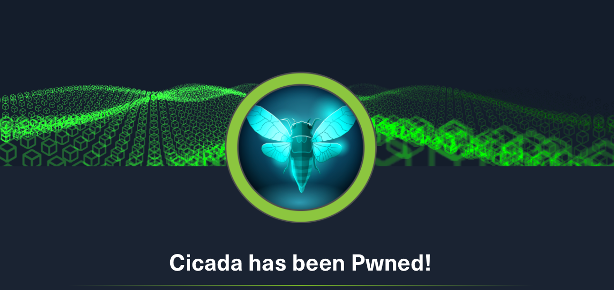
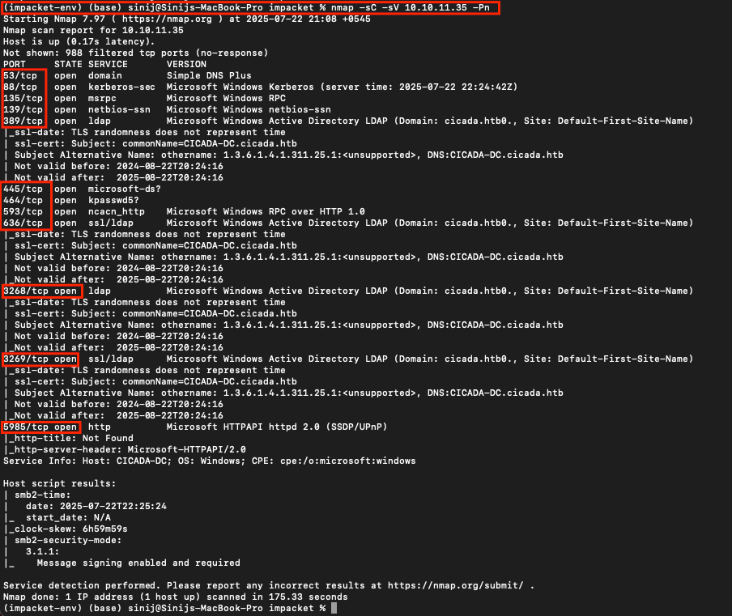
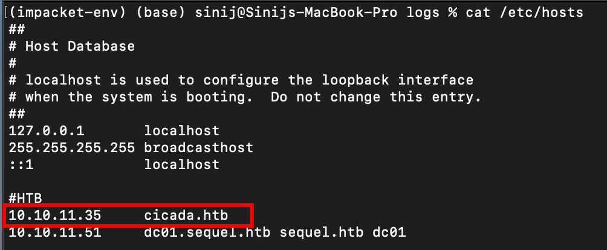
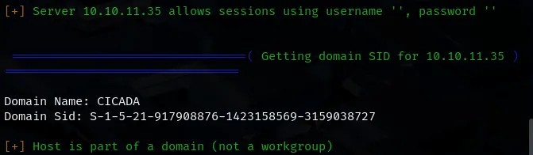
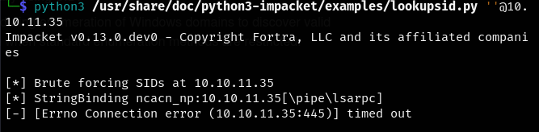
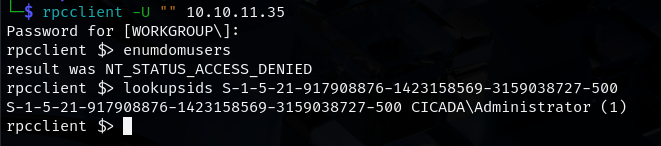

# Cicada — HTB

This writeup is a working challenge brief assembled from the captured screenshots and notes from the Cicada lab. The goal here is to preserve the investigation trail and keep the lab notes visible in the portfolio while the full narrative is being tightened up.

## Initial reconnaissance

The first pass focused on service discovery, ranking the likely entry points, and identifying the app stack before choosing the highest-value exploitation path.

## Target behavior and surface review

After enumerating the exposed services, the next step was to inspect the application flow and look for weaknesses in auth, request handling, and server-side logic.

## Exploitation notes

The screenshots in this folder capture the important pivot points as the challenge moves from discovery into active exploitation and validation.

## Follow-up and validation

The later notes document test validation, payload refinement, and the final steps that confirm the path to code execution or privilege abuse.

## Takeaway

The aim of this writeup is not to claim a final polished report where the full narrative is already complete, but to keep the challenge journey visible in the portfolio and move it forward as a structured research artifact.

**Working draft — challenge notes retained for later full writeup completion.**
